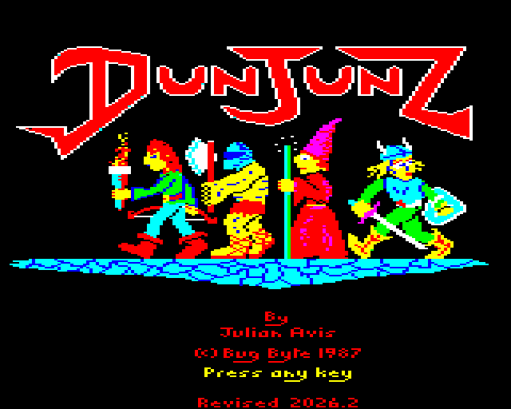

# Dunjunz Revised



**Dunjunz Revised**: a revised version of *Dunjunz*, the
four-player dungeon game by Julian Avis, published by Bug-Byte for the BBC
Micro in 1986 (cassette) and 1987 (disc).

The game is unchanged in spirit. The revision fixes bugs, keeps the game
resident instead of resetting the machine between levels, and loads
through whatever filing system is in use (DFS 0.90 to 2.2x, NFS and ANFS
over Econet), from a single disc. See [docs/plan.md](docs/plan.md).

## Provenance

The starting point is the Model B side of the official 1987 flippy disc,
as reassembled and annotated in the
[acornaeology Dunjunz disassembly](https://github.com/acornaeology/dunjunz).
`asm/original/` holds that reassembly, taken at acornaeology/dunjunz
commit `fd674e9`. The build checks it byte-for-byte against the original
files in `reference/disc/`. Every change from the original game is in this
repository's history.

This is not an official release, and it is not one of the earlier
unofficial versions (Ole's crack of the cassette, or the sideways RAM
hack). Every disc and title screen it builds says "Dunjunz Revised" and
its version.

## Credits and copyright

*Dunjunz* was written by Julian Avis and is copyright © Bug-Byte 1986.

The annotations and the revisions are copyright © Robert Smallshire.

This repository has no licence, deliberately. The revised game is
intertwined with the original program, which is copyright, so the default
copyright law applies to the whole repository. If the copyright holders
object to it being available, it will be taken down.

## Building

Requires [uv](https://docs.astral.sh/uv/) and
[beebasm](https://github.com/stardot/beebasm) 1.10 or later on the PATH.

```sh
uv sync
uv run dr-build        # build/dunjunz-revised-v<version>.ssd and .adl, and build/dunjunz-original.ssd (the 1987 baseline)
uv run pytest          # tests, in the beebium emulator
```

## Running it

Boot `dunjunz-revised-v<version>.ssd` (DFS, any BBC Micro) or
`dunjunz-revised-v<version>.adl` (ADFS, a Master or a Master Compact) with
SHIFT-BREAK, or copy the files to any filing system (a network file server
included) and `*RUN DUNJUNZ`. The game needs PAGE at &1C00 or below.
`*TYPE README` on either disc shows its version, how to play, and the
copyright notice; the disc titles carry the version too.

## Playing it

Up to four players share the keyboard, one hero each, or play with
joysticks: up to four through SPItFIRE on a Master Compact, otherwise two on
the analogue port (or a Compact's own joystick port). On the hero menu,
1-4 switch a hero in or out, fire on a joystick joins with that stick,
5 and 6 turn the sound on and off, and SPACE starts the game.

| Hero | Up | Down | Left | Right | Fire | Magic |
|---|---|---|---|---|---|---|
| Ranger | CAPS LOCK | SHIFT LOCK | SHIFT | Z | TAB | CTRL |
| Magic-User | → | ↑ | DELETE | COPY | ↓ | RETURN |
| Barbarian | K | , | . | / | SPACE | |
| Fighter | G | B | U | I | O | |

The Magic-User's arrow keys don't move the way they are labelled: → moves
up and ↑ moves down. Only the Ranger and the Magic-User can cast magic.
P pauses and resumes the game; holding ESCAPE for half a second ends it.
On a joystick, fire and a direction held together for half a second cast
magic.
